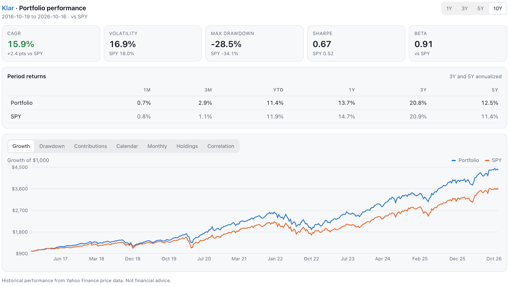

# Klar Portfolio Analytics for Claude

Klar turns Claude into a portfolio analyst. Attach a positions export from your brokerage (Fidelity, Schwab, Vanguard, Robinhood, Interactive Brokers and many international brokers) or just type your holdings, and ask Claude to analyze your portfolio. Klar runs the numbers on real market data and shows an interactive dashboard right in the conversation, and Claude explains what it means and answers your follow-up questions.



## What you can ask

- **"Analyze my portfolio."** Returns versus the S&P 500 (1 month to 10 years), annual growth rate, volatility, worst drawdown, Sharpe and Sortino ratios, beta, which holdings drove returns and risk, correlations, and calendar-year and monthly returns.
- **"What's really driving my returns?"** Fama-French factor analysis (CAPM, 3-factor, Carhart 4-factor, 5-factor): how much of your return comes from the market, company size, value, profitability, investment style and momentum, and whether any "alpha" is statistically meaningful.
- **"Am I on track to retire with $1M in 25 years?"** A 0–100 goal score covering required return, risk fit, diversification, drawdown resilience and the probability of reaching your target.
- **"What could my portfolio be worth in 20 years?"** Monte Carlo simulations with good, typical and bad-case outcomes, contributions and withdrawals.

The dashboard has controls for the period, the factor model and the time horizon, and Claude sees whatever you change.

## Install

**Claude (web, desktop and mobile):** open **Customize → Plugins**, search for **Klar**, and click **Add**. If Claude then asks you to connect Klar, click **Connect** once. There's no account or sign-in.

**Claude Code:**

```
/plugin marketplace add mirandag1099/klar-claude-plugin
/plugin install klar@klar-analytics
```

Then start a new conversation, attach your positions CSV, and say "analyze my portfolio." No account or API key is needed.

## What's in this plugin

- **Klar connector**: the tools Claude calls to load a portfolio, analyze performance, run factor regressions, score goals, simulate outcomes and look up tickers, plus the inline dashboard. They run on Klar's server at `https://mcp.klaranalytics.com/mcp`.
- **Klar skill**: the analyst playbook Claude follows: which analysis to run when, how to read each metric (`skills/klar/references/metrics.md`), and four modes (Analyst, Auditor, Planner, Coach).

## Good to know

- Results are based on historical prices from Yahoo Finance and factor data from the Kenneth French Data Library. Performance figures use price returns; factor regressions include dividends.
- Klar provides information and analysis, **not financial advice**. Past performance doesn't predict future results, and every decision stays yours.
- Klar keeps no accounts and no database. See [PRIVACY.md](PRIVACY.md) for exactly what data the server handles.

## Support

Questions, bugs or broker formats that don't load: [open an issue](https://github.com/mirandag1099/klar-claude-plugin/issues).

## License

[MIT](LICENSE)
